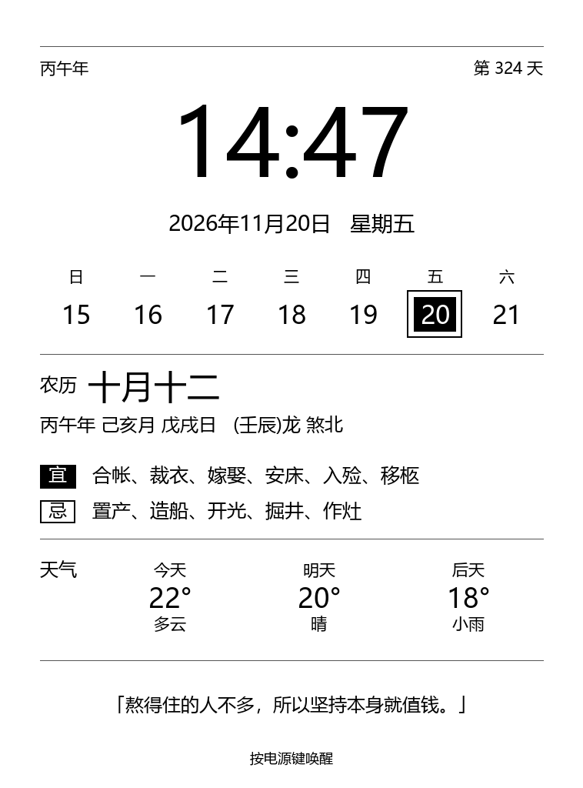

# Kindle 休眠屏保 Skill

给 Kindle 上的 KOReader 做一张自己的休眠屏保：大号时间 + 本周日历 + 农历干支 + 黄历宜忌 + 未来几天天气 + 一句短句。

全部在 Kindle 本机绘制，天气走 [Open-Meteo](https://open-meteo.com/) 免 API key。生成的是一份 Lua 补丁，丢进 `koreader/patches/` 就能用。



---

## 装成技能（推荐）

把下面这句话原样发给你在用的 AI 助手：

> 把 https://github.com/jjkepete/kindle-koreader-screensaver 装成技能，然后问我要什么样的屏保。

助手需要做的只有一步——把仓库拷进它的技能目录：

```sh
git clone --depth 1 https://github.com/jjkepete/kindle-koreader-screensaver <技能目录>/kindle-koreader-screensaver
```

技能目录看用的是什么工具：

| 工具 | 技能目录 |
| --- | --- |
| WorkBuddy / CodeBuddy | `~/.workbuddy/skills/` |
| Claude Code | `~/.claude/skills/` |
| Codex CLI | `~/.codex/skills/` |
| 其它 | 该工具自己的 skills 目录 |

装完直接说「给我的 Kindle 做屏保」就会触发。仓库根目录就是技能根目录，`SKILL.md` 在里面，不用再套一层。

---

## 它不会上来就生成

初始描述里几乎不可能把参数说全，所以它会分轮问你，答完再动手：

| 轮次 | 问什么 |
| --- | --- |
| 前提 | 是否已越狱并装了 KOReader；是不是广告版（广告版拿不到系统闹钟，定时刷新会失效） |
| 第一轮 | 时间是否要自动走：整点刷 / 每小时内的固定间隔 / 不刷（定格，零耗电）；天气几天；短句用内置还是自己写；内容全要还是精简 |
| 第二轮 | 城市（只报城市名，坐标它自己查）；夜间免打扰时段；自定义句子 |
| 第三轮 | 用一张表复述全部参数，确认后再生成 |

后续临时想加东西（比如"能不能加个倒计时"），它会先问清四件事再动手：数据从哪来、多久更新、放哪个位置、拿不到数据时显示什么。

---

## 不想装技能，直接生成

```sh
# 需要 Python 3.8+，无第三方依赖
python scripts/build_patch.py --out ./2-blbscreen.lua \
  --wake 60 --wake-from 7 --wake-to 23 \
  --weather-days 3 --lat 39.91 --lon 116.40 --city 北京 \
  --quotes builtin
```

| 参数 | 说明 |
| --- | --- |
| `--out` | 输出的 `2-blbscreen.lua` 路径 |
| `--wake` | 唤醒间隔（分钟）：`60` 整点、`30` 半点、`0` 或 `--no-wake` 定格 |
| `--wake-from` / `--wake-to` | 允许唤醒的整点范围，默认 `7`–`23`，避免夜里闪屏 |
| `--weather-days` | 天气显示 `1` / `2` / `3` 天 |
| `--lat` `--lon` `--city` | 天气取点坐标与名字（城市名只写日志，不上屏） |
| `--no-weather` | 完全不要天气 |
| `--quotes` | `builtin` 内置 80 句 / `custom` 用 `--quotes-file` / `off` 不要 |
| `--quotes-file` | 自定义句库，UTF-8 纯文本，一行一句 |
| `--hide` | 隐藏区块，逗号分隔：`header,clock,date,week,lunar,huangli,quote,footer` |
| `--font-scale` | 字号倍率，`0.9`–`1.15` |
| `--json` | 全部选项写成 JSON 文件一次传入 |

版式按屏幕高度等比缩放，PW2（600×800）、KPW3（300 ppi）、Oasis 都能用同一份补丁，不用改坐标。

城市坐标表在 `assets/city-coords.txt`（50 个常用城市）。表里没有的，把下面链接里的拼音换掉，浏览器打开看 `latitude` / `longitude`：

```
https://geocoding-api.open-meteo.com/v1/search?name=jinjiang&count=1&language=zh&format=json
```

---

## 装到 Kindle

1. Kindle 已越狱，并且装了 KOReader
2. `2-blbscreen.lua` → `koreader/patches/`
3. `assets/huangli.lua` 和 `assets/plugin-main.lua` → `koreader/plugins/blbscreen.koplugin/`，后者改名为 `main.lua`
4. 安全弹出、拔线
5. **退出 KOReader 再重新进入**（patch 只在启动时加载）
6. 按电源键休眠，看效果

### 验证定时刷新

设备根目录建一个空文件 `koreader/blbscreen.fastwake`，唤醒间隔会变成 180 秒。休眠三分钟看时间有没有跳，验证完删掉。

`screensaver_type` 必须是图片模式，`settings.reader.lua` 里应该是：

```lua
["screensaver_type"] = "cover",
["screensaver_img_background"] = "white",
```

---

## 前提与限制

- **必须是不带广告的 Kindle**。广告版（Special Offers）下 KOReader 拿不到系统闹钟，定时刷新会静默失效，只剩"入睡瞬间那一张"。
- 水墨屏休眠时 CPU 挂起，屏保是入睡那一刻画好的静态 PNG。想让它走时，只能定时唤醒重绘，代价是待机时间：每小时唤醒一次大约多耗 10%–20%。
- 每次刷新都是整屏刷新，屏幕会闪一下。
- 黄历数据覆盖 2025-12-01 至 2027-12-31，到期需要重新生成。
- 天气需要 Wi-Fi；联网只发生在阅读期间的后台预热，休眠唤醒时不联网，读的是缓存。完全没有缓存时显示 `--`。

---

## 目录

```
SKILL.md                        技能说明与提问流程
assets/2-blbscreen.template.lua 补丁模板（CFG 段由脚本改写）
assets/huangli.lua              黄历数据，761 天
assets/plugin-main.lua          KOReader 插件占位入口
assets/quotes-default.txt       内置 80 句
assets/city-coords.txt          50 个城市经纬度
scripts/build_patch.py          按选项生成补丁
scripts/build_install_pack.py   生成免 AI 的直装包
references/install.md           安装与排错细节
references/options.md           全部选项说明
```

## 许可

MIT。黄历数据自行生成，天气数据来自 Open-Meteo（非商用免费）。
